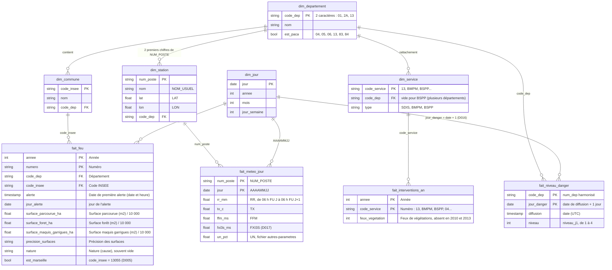

# Modèle de données

Dernière mise à jour : 2026-11-18
Proposé par : Ghiles MEKDAM, à partir de la v0 du groupe et des fiches de `docs/sources/`
Statut : **proposition, à valider par le groupe** (stack : [D018](decisions.md))

Ce document décrit comment les quatre sources fichées sont chargées, nettoyées et assemblées pour répondre aux questions de la liste commune (Q1 à Q5, voir la [matrice](sources/matrice.md)). Seules figurent les colonnes relevées dans les fichiers ou les fiches, et utiles à une question.

## 1. Stack

| Rôle | Outil |
|---|---|
| Environnement | Python 3.13, dépendances gérées avec `uv` |
| Base | DuckDB : un seul fichier `data/sdis13.duckdb`, sans serveur |
| Transformations | Scripts SQL exécutés dans l'ordre par un script Python |
| Contrôles qualité | Requêtes SQL lancées par `pytest` |
| Analyse et rendu | Notebooks (pandas, matplotlib) |

Pourquoi : les volumes sont petits (36 000 bulletins, quelques dizaines de milliers de feux, quelques millions de mesures météo pour PACA). DuckDB lit directement les `.csv.gz`, accepte les deux séparateurs (`,` et `;`) et ne demande aucune installation de serveur aux trois membres.

## 2. Les trois couches

```
data/raw/        fichiers téléchargés, jamais modifiés (hors git)
   │
   ▼  staging : une vue par source, colonnes typées et renommées, années empilées
   │
   ▼  core : les tables du modèle (faits + référentiels), une règle de jointure = un endroit
   │
   ▼  marts : les tables qui répondent aux questions
```

| Couche | Ce qu'on y fait | Ce qu'on n'y fait pas |
|---|---|---|
| `staging` | Typer les colonnes, harmoniser les codes département, empiler les années, convertir les m² en ha | Aucune jointure entre sources |
| `core` | Construire les référentiels, appliquer les règles de jointure (D016) | Aucun calcul de taux ou de seuil |
| `marts` | Compter, agréger, comparer les seuils | Aucun nettoyage |

## 3. Schéma du cœur (`core`)



### Les tables de faits

| Table | Source | Une ligne = | Clé | Période chargée | Questions |
|---|---|---|---|---|---|
| `fait_feu` | [BDIFF](sources/fiche-bdiff-ouissem-aouimeur.md) | un feu | `annee` + `numero` (unique d'après la fiche) | PACA 2006-2025 (D006) ; France 2024-2025 (D014) | Q1, Q2, Q3, Q4, Q5 |
| `fait_niveau_danger` | [Météo des forêts](sources/fiche-archives-meteo-des-forets.md) | un département × un jour du danger | `code_dep` + `jour_danger` | saisons 2024, 2025, 2026 | Q3, Q4, Q5 |
| `fait_meteo_jour` | [Données climatologiques](sources/fiche-donnees-climatologiques-quotidiennes.md) | une station × un jour | `num_poste` + `jour` | PACA, période à fixer (D012) | Q3 (proxy) |
| `fait_interventions_an` | [Interventions SDIS](sources/fiche-interventions-sdis.md) | un service × une année | `annee` + `code_service` | années ouvertes de 2008 à 2024 | Q5 |

### Les référentiels

| Référentiel | Construit à partir de | État |
|---|---|---|
| `dim_jour` | généré (un jour par ligne, de 2006-01-01 à 2026-12-31) | rien à télécharger |
| `dim_departement` | contour GeoJSON fourni avec la Météo des forêts | fichier déjà téléchargé |
| `dim_commune` | COG de l'INSEE (source non fichée, millésime à fixer). En attendant : `Code INSEE` + `Nom de la commune` de la BDIFF | à ficher |
| `dim_station` | `NUM_POSTE`, `NOM_USUEL`, `LAT`, `LON`, répétés sur chaque ligne de mesure | dérivé ; `NOM_USUEL`, `LAT` et `LON` ne sont pas relevés dans la fiche : noms à vérifier dans le fichier |
| `dim_service` | valeurs distinctes de `Numéro` dans les interventions, rattachées à la main | dérivé + 3 lignes saisies |

## 4. Les règles de nettoyage (`staging`)

1. **Code département sur 2 caractères partout** : `1` → `01`, `4` → `04`. `2A` et `2B` restent tels quels.
2. **Météo des forêts** : lire les trois fichiers avec leur séparateur (`,` en 2024-2025, `;` en 2026) et renommer `dep_nom` (2025) en `nom_dep`.
3. **BDIFF** : sauter les 3 lignes d'information avant l'en-tête, séparateur `;`, empiler les exports (PACA, France par année). Supprimer les doublons sur `Année` + `Numéro` qu'un recouvrement d'exports créerait.
4. **Surfaces** : convertir les m² en hectares (÷ 10 000), car le site et la direction parlent en hectares.
5. **Météo** : mettre à vide une valeur dont le code qualité vaut 2 (douteuse, en cours de vérification).
6. **Interventions** : mapper les colonnes année par année (16 à 71 colonnes selon l'année). `feux_vegetation` reste vide en 2010 et 2013, il n'est pas mis à 0.

## 5. Les règles de jointure (`core`)

1. **Jour du danger (D016)** : `jour_danger = date de diffusion + 1 jour`. Vérifié sur les trois fichiers : les bulletins sont diffusés entre 14 h 50 et 16 h UTC, donc toujours le même jour en heure de Paris. Un contrôle bloque le chargement si une diffusion passe après 22 h UTC.
2. **On garde `niveau_j1` seulement.** `niveau_j2` est une prévision à deux jours, moins fiable, et ferait deux niveaux pour le même jour.
3. **Marseille (D005)** : les feux de Marseille ne sont pas supprimés, ils sont marqués (`est_marseille`). Chaque table de `marts` existe avec et sans Marseille, tant que D005 n'est pas tranchée. La Météo des forêts, à l'échelle du département, ne permet pas de les séparer.
4. **Stations** : rattachées au département par les 2 premiers chiffres de `NUM_POSTE`, jamais à une commune (le numéro de commune du poste n'est pas forcément la commune actuelle de la station).
5. **Pluie avant un feu** : utiliser `rr_mm` du jour J-1 (voir la fiche climatologie, piège 1).

## 6. Les tables qui répondent aux questions (`marts`)

### `mart_jour_departement` : la table centrale (Q3, Q4, Q5)

Une ligne = un département × un jour. **Tous les jours y figurent, y compris ceux sans feu** : sinon on ne peut pas calculer la part des jours avec feu.

| Colonne | Calcul |
|---|---|
| `code_dep`, `jour` | produit de `dim_departement` et `dim_jour` |
| `niveau` | `fait_niveau_danger.niveau`, **vide hors saison** (pas de bulletin : le niveau est inconnu, pas « faible ») |
| `nb_feux`, `surface_ha` | feux de `fait_feu` dont `jour_alerte` = `jour` |
| `nb_feux_hors_marseille`, `surface_ha_hors_marseille` | idem, sans `est_marseille` |
| `jour_avec_feu` | `nb_feux` ≥ 1 |
| `rr_veille_mm`, `tx_max_c`, `fxi3s_max_ms` | météo des stations du département (veille pour la pluie) |

Pour la question du seuil, on ne garde que les lignes où `niveau` n'est pas vide, et seulement 2024-2025 (la BDIFF 2026 n'est pas publiée, D012).

### `mart_seuil` (Q3, Q4, Q5)

Une ligne = un département × une année × un seuil possible (2, 3 ou 4). Pour un seuil *s*, un jour est « déclenché » si `niveau` ≥ *s*.

| Colonne | Sens |
|---|---|
| `jours_declenches` | jours de renfort : ce que coûte le seuil (Q4, en jours, D013) |
| `jours_declenches_avec_feu` | déclenchements utiles |
| `fausses_alertes` | jours déclenchés sans aucun feu (voir le [glossaire](glossaire.md)) |
| `feux_manques` | feux partis un jour non déclenché |
| `surface_manquee_ha` | surface de ces feux manqués |

### `mart_commune_annee` (Q1)

Une ligne = une commune × une année : `nb_feux`, `surface_ha`, rang de la commune dans le département. Elle permet de voir si les mêmes communes reviennent d'une année sur l'autre (D010).

### Q2 et la comparaison annuelle de Q5

- **Q2** se calcule directement sur `fait_feu` : mois, jour de la semaine et heure de `alerte` (D011).
- **Q5** sur la durée : `fait_interventions_an` donne les volumes annuels par service, sans lien avec l'indice (D014).

## 7. Les contrôles qualité

Lancés après chaque chargement. Un contrôle qui échoue arrête le pipeline.

| Contrôle | Attendu |
|---|---|
| Unicité des clés | aucun doublon sur la clé de chaque table de faits |
| Un seul bulletin par département et par jour | aucun doublon sur `code_dep` + `jour_danger` |
| Niveaux | `niveau` entre 1 et 4 |
| Heure de diffusion | toutes avant 22 h UTC (sinon D016 décale d'un jour de trop) |
| Codes département | tous présents dans `dim_departement` |
| Volumes de la Météo des forêts | 35 616 lignes au total, dont 371 pour le 13 (fiche) |
| Volumes de la BDIFF | 10 789 feux en PACA de 2006 à 2025 (fiche) |
| Feux sans jour | aucun feu sans `jour_alerte` |

## 8. Organisation des fichiers

```
pyproject.toml            dépendances (duckdb, pandas, matplotlib, pytest)
data/raw/                 hors git
  meteo-des-forets/       3 fichiers .csv.gz
  bdiff/                  exports CSV, téléchargés à la main (le site impose un formulaire)
  climatologie/           fichiers .csv.gz par département
  interventions/          un CSV par année
data/sdis13.duckdb        hors git, reconstruit par le pipeline
pipeline/
  telecharger.py          télécharge tout ce qui peut l'être
  construire.py           exécute les SQL dans l'ordre
  sql/staging/  sql/core/  sql/marts/
tests/                    contrôles qualité (section 7)
notebooks/                analyses et graphiques du rendu
```

## 9. Ce qui n'est pas modélisé, et pourquoi

- **Le coût d'une journée de renfort, le budget et le seuil actuel** : aucune source ne les contient (D013). `mart_seuil` donne des jours ; la conversion en euros attend la réponse du SDIS 13.
- **Les massifs** : aucune source de l'inventaire (D010).
- **Les autres colonnes** des sources : seules celles utiles à une question sont chargées.
- **L'indice recalculé à partir de la météo (proxy de l'IFM)** : sa faisabilité n'est pas vérifiée (D012). `fait_meteo_jour` contient déjà les colonnes nécessaires.

## 10. Ce qui change par rapport à la v0

| v0 | Cette version | Pourquoi |
|---|---|---|
| Clé d'un feu « non relevée » | `annee` + `numero` | Les colonnes `Année` et `Numéro` sont dans l'export, et la fiche BDIFF dit qu'elles sont uniques |
| Interventions reliées au département | `dim_service` entre les deux | `BMPM` et `BSPP` ne sont pas des départements |
| Pas de table jour × département | `mart_jour_departement`, avec les jours sans feu | C'est le grain des questions Q3 à Q5 |
| Hors saison non traité | `niveau` vide hors saison | Pas de bulletin ne veut pas dire danger faible |
| Surfaces : seulement la surface parcourue | + forêt, maquis et garrigues, précision des surfaces, cause | Définition d'un feu de forêt (glossaire), qualité de la surface |
| Météo sans humidité ni code qualité | + `UN`, règle sur les codes qualité | Nécessaires pour le proxy de l'IFM (D012) |
| Pas de contrôles | Section 7 | Vérifier chaque chargement contre les chiffres des fiches |
