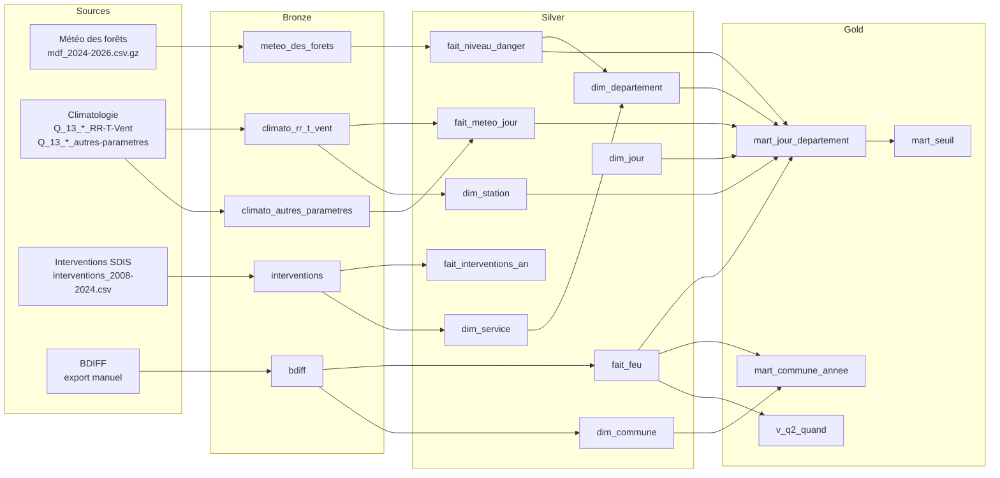

# Pipeline de données

Dernière mise à jour : 2026-11-18

Ce document explique comment reconstruire la base `data/sdis13.duckdb` à partir des sources, ce que contient chaque couche, et ce que le pipeline ne sait pas faire. Il met en œuvre le [modèle de données](modele-donnees.md) (branche `docs/modele-donnees`) et la pile de [D018](decisions.md) : Python 3.13, `uv`, DuckDB, `pytest`.

## 1. Lancer le pipeline

Prérequis : [`uv`](https://docs.astral.sh/uv/) dans le PATH. `uv` installe lui-même Python 3.13 et les dépendances.

```
uv run python -m pipeline.construire
```

Cette seule commande :

1. télécharge dans `data/raw/` ce qui manque (Météo des forêts, climatologie, interventions SDIS), en lisant les URL dans l'API de data.gouv.fr ;
2. charge bronze, contrôle le schéma et les volumes (barrière « extraction ») ;
3. construit silver puis gold ;
4. contrôle le modèle (barrière « modèle ») et écrit [`docs/qualite/rapport-qualite.md`](qualite/rapport-qualite.md).

Elle se relance sans risque : toutes les tables sont recréées (`CREATE OR REPLACE`), sauf le journal de chargement, qui garde l'historique. Une reconstruction complète prend environ 45 secondes.

| Besoin | Commande |
|---|---|
| Reconstruire sans réseau (fichiers déjà présents) | `uv run python -m pipeline.construire --hors-ligne` |
| Télécharger seulement | `uv run python -m pipeline.telecharger` |
| Lancer les tests | `uv run pytest` |
| Charger la climatologie de toute la région PACA | `CLIMATO_DEPARTEMENTS=13,04,05,06,83,84`, puis la commande ci-dessus |

**BDIFF** : le site impose un formulaire, donc l'export se télécharge à la main sur [bdiff.agriculture.gouv.fr](https://bdiff.agriculture.gouv.fr/incendies) et se dépose dans `data/raw/bdiff/` (ZIP ou CSV). Sans export, le pipeline ne s'arrête pas : il le signale, crée des tables de feux vides et marque « non évaluables » les règles de qualité qui en dépendent.

Si une règle de qualité « block » échoue, le pipeline s'arrête avec un code de sortie 1 et le rapport indique la règle en cause.

## 2. Les trois couches

| Couche | Schéma DuckDB | Ce qu'on y fait | Ce qu'on n'y fait pas | Fichiers |
|---|---|---|---|---|
| Bronze | `bronze` | Copier chaque fichier tel qu'il arrive : toutes les valeurs en texte, noms de colonnes d'origine, plus `_fichier_source` et `_date_chargement` | Aucun typage, aucun renommage, aucun filtre | `pipeline/bronze.py`, `sql/bronze/` |
| Silver | `silver` | Typer, harmoniser (code département sur 2 caractères, `nom_dep`/`dep_nom`), appliquer les règles des fiches et des décisions, construire l'étoile (faits + dimensions), envoyer les lignes non conformes en file de rejet | Aucun calcul de taux ou de seuil | `sql/silver/` |
| Gold | `gold` | Compter, agréger, comparer les seuils : les tables qui répondent à Q1 à Q5 | Aucun nettoyage | `sql/gold/` |

Les fichiers SQL de chaque couche s'exécutent dans l'ordre de leur nom (`10_…`, `20_…`). Quand une source manque (BDIFF), le fichier du même nom dans `sql/silver/si_absent/` le remplace et crée des tables vides au même schéma.

### Correspondance avec le modèle de Ghiles

| Modèle (`modele-donnees.md`) | Ce pipeline | Différence |
|---|---|---|
| `data/raw/` | `data/raw/` + schéma `bronze` | Bronze ajoute une copie des fichiers bruts dans DuckDB, avec le journal de chargement : on peut contrôler le schéma et les volumes avant toute transformation |
| `staging` + `core` | `silver` | Le nettoyage (staging) et l'étoile (core) sont réunis dans une seule couche ; les files de rejet y sont ajoutées |
| `marts` | `gold` | Même contenu |

Cette architecture est proposée comme décision D019 dans la description de la PR.

## 3. Lineage : de la source à la table qui répond



| Table gold | Répond à | Construite à partir de |
|---|---|---|
| `mart_jour_departement` | Q3, Q4, Q5 | `dim_departement` × `dim_jour`, `fait_niveau_danger`, `fait_feu`, `fait_meteo_jour` + `dim_station` |
| `mart_seuil` | Q3, Q4, Q5 | `mart_jour_departement` (saisons 2024 et 2025) |
| `mart_commune_annee` | Q1 (D010) | `fait_feu`, `dim_commune` |
| `v_q2_quand` (vue) | Q2 (D011) | `fait_feu` |

Les interventions (`fait_interventions_an`) servent directement la comparaison des volumes annuels de Q5 (D014), sans lien avec l'indice.

### Règles appliquées en silver

| Règle | Où | Origine |
|---|---|---|
| Code département sur 2 caractères (`1` → `01`, `2a` → `2A`) | macro `silver.code_dep` | modèle, fiches |
| Jour du danger = date de diffusion + 1 jour ; `niveau_j1` seulement | `20_meteo_des_forets.sql` | D016 |
| Valeur climatologique à NULL si son code qualité vaut 2 | macro `silver.mesure` | fiche climatologie |
| Rafale du jour = `FXI3S` | `30_climatologie.sql` | D017 |
| Station rattachée au département par les 2 premiers chiffres de `NUM_POSTE` | `dim_station` | modèle |
| Interventions mappées année par année (16, 70 ou 71 colonnes) ; « Feux de végétations » NULL (jamais 0) quand la colonne manque ou vaut `N.C.` | `silver.interventions_mapping` | fiche interventions, en-têtes réels |
| Nombres en texte (`3 142`, `1?403`) convertis en entiers | macro `silver.entier_texte` | fichiers réels |
| BMPM et BSPP sont des services, pas des départements | `dim_service` | D005, fiche interventions |
| BDIFF : clé `Année` + `Numéro`, doublons en file de rejet, m² → ha, `est_marseille` | `50_bdiff.sql` | fiche BDIFF, D005 |
| `dim_commune` préparée en SCD type 2 (`valide_du`, `valide_au`, `est_courant`) | `50_bdiff.sql` | cours (étoile historisée) |

Une ligne non conforme n'est jamais supprimée en silence : elle va dans `silver.rejet_<source>` avec son motif. Les tests vérifient que bronze = silver + rejets pour chaque source.

## 4. Journal de chargement

`bronze.journal_chargement` reçoit une ligne par fichier et par exécution :

| Colonne | Contenu |
|---|---|
| `run_id` | identifiant de l'exécution |
| `fichier` | nom du fichier (pour un ZIP BDIFF : `archive.zip/fichier.csv`) |
| `empreinte_sha256` | empreinte du fichier téléchargé : elle change si la source a été mise à jour |
| `taille_octets` | taille du fichier |
| `nb_lignes` | lignes chargées en bronze |
| `date_chargement` | date et heure de l'exécution |
| `statut` | `charge`, ou `absent` pour une BDIFF non déposée |

## 5. Qualité

Les règles sont dans `pipeline/qualite.py`. Chacune a une portée (la table et les lignes concernées), un prédicat (une requête qui renvoie un nombre), un seuil et une sévérité :

- **block** : un échec arrête le pipeline (schéma, volumes de la Météo des forêts, unicité des clés, niveaux de 1 à 4, diffusion avant 22 h UTC pour D016, orphelins, complétude de la Météo des forêts en PACA) ;
- **warn** : un échec est signalé dans le rapport, le pipeline continue (autres volumes, complétude de la BDIFF, `N.C.`, valeurs douteuses, chutes de plus de 30 % du nombre de stations, lignes en file de rejet).

Le rapport [`docs/qualite/rapport-qualite.md`](qualite/rapport-qualite.md) est régénéré à chaque exécution.

## 6. Limites connues

- **BDIFF manuelle** : sans export déposé, les tables de feux sont vides et les colonnes de feux de gold valent NULL (jamais 0) : `feux_connus` indique si les feux d'un département et d'une année sont chargés. Les noms de colonnes BDIFF utilisés en silver viennent de la fiche et du glossaire ; ils n'ont pas encore été vérifiés sur un fichier, et le contrôle de schéma bloquera s'ils diffèrent.
- **Saison 2026 absente de la BDIFF** : la Météo des forêts couvre 2026, mais la BDIFF n'est pas publiée. L'analyse du seuil porte sur 2024 et 2025 seulement (D012).
- **Seuil actuel et coût d'une journée de renfort inconnus** (D013) : `mart_seuil` donne des jours de renfort, de fausses alertes et de feux manqués, pas des euros.
- **Périmètre hors Marseille** ([D005](decisions.md), non tranchée) : `mart_seuil` existe pour tout le département et sans Marseille. Sans Marseille, seuls les feux changent : le niveau de la Météo des forêts reste celui de tout le département, qui ne peut pas être séparé.
- **`dim_departement` construite sans le GeoJSON prévu par le modèle** : les 96 départements de métropole et leurs noms viennent de la Météo des forêts, les 5 départements d'outre-mer des interventions SDIS. Le GeoJSON n'est utile que pour une carte ; il pourra être ajouté sans changer les clés.
- **Climatologie à partir de 2006 en silver** (comme `dim_jour`, D006) ; bronze garde tout depuis 1950. La période reste à fixer si D012 rallonge l'historique.
- **Climatologie du 13 seulement par défaut** : la météo des autres départements de PACA est NULL tant que `CLIMATO_DEPARTEMENTS` ne les inclut pas. Les stations de Corse commencent par `20`, qui n'est pas un code de `dim_departement` : à traiter si on les charge.
- **Feux manqués** : comptés en feux (`feux_manques`) et en jours (`jours_avec_feu_manques`), car les deux mesures ne donnent pas le même résultat (glossaire).
- **`dim_commune`** : une seule version par commune tant qu'aucun référentiel COG n'est chargé ; aucun historique n'est inventé.
